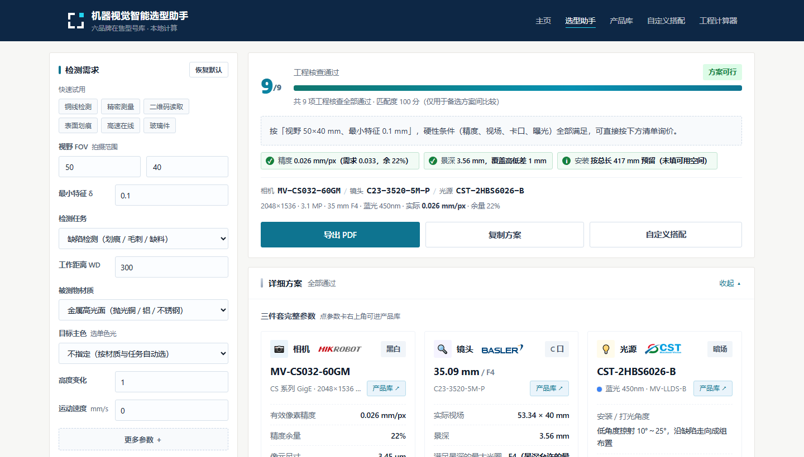

<p align="center"></p>

<h1 align="center">机器视觉智能选型助手</h1>

<p align="center">输入检测需求，直接给出可询价的「相机 + 镜头 + 光源」型号。</p>

<p align="center">
  <a href="https://github.com/549763551/vision-selector/actions/workflows/test.yml"></a>
  <a href="https://549763551.github.io/vision-selector/home.html"></a>
  <a href="LICENSE"></a>
</p>

---

## 这是什么

做机器视觉选型，通常是从「要拍多大范围、要多细的精度」倒推一堆光学计算，再去型录里翻型号对参数，很容易算错、漏配，或者配出一套装不下的方案。

这个工具把这段流程搬到了网页上：填几个参数，输出一套**能直接下单的型号**，而不是「300 万像素相机」这种泛称；配套的算式、评分、风险、安装清单全部摊开，可以逐项复核。

纯前端静态页面，**双击 `home.html` 就能用**——不装环境、不联网，也不向任何服务器上传数据。

<p align="center"></p>

## 页面一览

| 页面 | 做什么 |
|---|---|
| **主页** `home.html` | 四个页面的统一入口，实时统计各品牌型号数量，并按品牌分组直达六家厂商的官方手册与资料（211 条，均可搜索）。 |
| **选型助手** `index.html` | 填视野、最小特征、检测任务、材质、工作距离、节拍，自动推导「相机 + 镜头 + 光源」整套方案。给出像素精度、所需分辨率、焦距、视场、景深、衍射、曝光上限、帧率与带宽的完整代入过程，以及评分构成、与次优方案的逐项对比、现场参数起始值、安装配套清单、验收复核清单；方案可整段复制或加入询价清单。面阵不够用时自动给线扫方案，高度测量给 3D 轮廓传感器。 |
| **产品库** `library.html` | **8850** 个型号按类别 / 品牌 / 接口 / 卡口 / 焦距 / 颜色 / 红外波段筛选，型号与传感器关键词搜索（在别的页签也能命中），多型号横向对比、相机反查适配镜头、跨品牌等价型号、收藏与询价清单，每个型号带示意图与全参数。另有 **198** 个已停产型号可查，附退市年份、官方依据与替代型号（不参与选型推荐）。 |
| **自定义搭配** `combo.html` | 自己挑相机 / 镜头 / 光源，用与自动选型完全相同的公式逐项判定卡口、像面、解析力、精度、景深、曝光、帧率带宽、照明匹配，给出分数、等级，以及不达标项的一键替换建议。满意后可直接带回选型助手。 |

四个页面顶部是同一组导航，当前页高亮，窄屏自动变单行横滑；手机上也能完整操作。

## 在线使用

| 页面 | 地址 |
|---|---|
| 主页 | https://549763551.github.io/vision-selector/home.html |
| 选型助手 | https://549763551.github.io/vision-selector/ |
| 产品库 | https://549763551.github.io/vision-selector/library.html |
| 自定义搭配 | https://549763551.github.io/vision-selector/combo.html |

GitHub Pages 托管，打开网址就能用；也可以 Clone 后离线使用（见下文「本地运行」）。

## 型号库覆盖

| 品牌 | 面阵相机 | 线阵相机 | 工业镜头 | 远心镜头 | 光源 | 光源控制器 | 3D | 工控机 | 红外相机 | 小计 |
|---|---:|---:|---:|---:|---:|---:|---:|---:|---:|---:|
| 海康机器人 HIKROBOT | 406 | 33 | 101 | 7 | 211 | 23 | 119 | 20 | 10 | **930** |
| 华睿（大华机器视觉） | 300 | 26 | 69 | 16 | 262 | 20 | — | — | — | **693** |
| Basler（宝视纳） | 474 | 27 | 46 | 22 | 261 | 2 | 24 | — | — | **856** |
| 大恒图像 | 688 | — | 578 | 211 | — | — | — | — | — | **1477** |
| 奥普特 OPT | 118 | 24 | 278 | 619 | 2134 | 43 | — | 21 | — | **3237** |
| 康视达 CST | 53 | 8 | 91 | 48 | 1431 | 26 | — | — | — | **1657** |
| **合计** | **2039** | **118** | **1163** | **923** | **4299** | **114** | **143** | **41** | **10** | **8850** |

数据全部来自各品牌公开产品手册与官网产品页，由 `tools/` 下的脚本逐型号抽取，每个型号都能追到出处；口径与已知缺口见 [docs/data.md](docs/data.md)。

> **选型链的纳入口径**：六品牌的面阵 / 线阵相机、定焦 / 远心镜头、光源（含配套控制器）只要在售且参数齐全就一起比选。
> 退市型号（4 款与退市库重名）与必要参数缺失的型号（363 款，如康视达面阵相机缺卡口、变倍镜头无定焦距、光源缺尺寸）由
> [`selection-catalog.js`](selection-catalog.js) 统一挡在选型链外，产品库仍可查这些型号。
> 3D / 智能相机 / 红外 / 工控机 / 非标产品不属于「相机 + 镜头 + 光源」分离选型算路，不参与比选。

## 为什么结果可信

- **算术全摊开**：像素精度、焦距、视场、景深、衍射、曝光、帧率、带宽，每一项都在页面上给出公式与代入值，可以拿计算器复核；不确定的地方（照度、像差、装夹）会明确标成风险，而不是假装算得准。
- **按匹配度选最优，不是「第一个达标就返回」**：全部品牌一起比较，综合精度余量、景深、衍射、曝光、焦距误差、视场过剩、帧率、带宽打分，分数构成与扣分原因逐项列出。
- **跨品牌可替换**：同规格型号自动互标，相机与镜头都能一键换成别家的等价型号，方便按供货和价格二选一。
- **有测试兜底**：118 项单元测试覆盖光学计算自洽、型号匹配、跨品牌合并、全量选型池清洗与品牌开关、边界与非法输入，每次 push 由 CI 自动跑。

## 本地运行

```bash
git clone https://github.com/549763551/vision-selector.git
cd vision-selector
# 直接双击 home.html 即可；或起个静态服务
python -m http.server 8080
npm test        # 110 项单元测试
```

没有构建步骤，改完文件刷新就能看到。想改选型规则只动 `engine.js`，想改界面只动对应页面与 `app.js`。

## 更多文档

| 文档 | 内容 |
|---|---|
| [docs/usage.md](docs/usage.md) | 操作说明：表单怎么填、同系列与备选怎么切换、收藏与询价清单、搭配页怎么用 |
| [docs/algorithm.md](docs/algorithm.md) | 输入项清单、算路口径（公式与取值表）、精度预算、安装空间、现场参数、验收标准，以及这套算法的边界 |
| [docs/data.md](docs/data.md) | 型号库怎么从手册和官网生成、各品牌抓取口径、目录结构、接入新品牌的最小步骤、开发与发布 |
| [CHANGELOG.md](CHANGELOG.md) | 版本更新记录 |

## 关于

- 本项目是个人开发的第三方选型辅助工具，**不是任何厂商的官方产品**，不代表官方推荐或背书。
- 页面中的各品牌字标仅用于标注型号库的数据来源，商标归对应公司所有；商用或公开发布前请自行评估商标使用规范，或删除 `assets/` 下的标识文件。
- 型号参数取自公开资料，可能随厂商更新而变化；**采购前请以官方最新资料为准**。价格、货期、库存未入库。
- 手机上也可以选型、查型号：

  

## License

[MIT](LICENSE)
